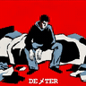

# 🛏️ Bed Bounce — *Khela ya nhi yeh* 😂🤣

## 🎮 Play Now

[](https://xdotdex.github.io/Fuckgames/)
[](https://t.me/BedBouncebot)

▶️ **Web:** https://xdotdex.github.io/Fuckgames/ — no install, just open and play!
🤖 **Telegram:** [@BedBouncebot](https://t.me/BedBouncebot) — play right inside Telegram!

## 🏆 Leaderboard & 🎁 Giveaway

The game has a **live global leaderboard** — every score lands on the same board, wherever you play from.

### 📊 Live Standings

<!-- LEADERBOARD:START -->
<table>
<tr><th>#</th><th width="44%">Player</th><th>Score</th><th>Prize</th><th>Icon</th></tr>
<tr><td>🥇</td><td> Dalim&nbsp;Gay</td><td>178</td><td>$50</td><td></td></tr>
<tr><td>🥈</td><td> DEメTER</td><td>56</td><td>$30</td><td></td></tr>
<tr><td>🥉</td><td> fuck</td><td>47</td><td>$20</td><td></td></tr>
<tr><td>4</td><td> Lola&nbsp;Hill</td><td>26</td><td>$0</td><td>-</td></tr>
<tr><td>5</td><td> David&nbsp;Bennet</td><td>25</td><td>$0</td><td>-</td></tr>
<tr><td>6</td><td> Frank&nbsp;Lewis</td><td>16</td><td>$0</td><td>-</td></tr>
<tr><td>7</td><td> NeonWhale</td><td>15</td><td>$0</td><td>-</td></tr>
<tr><td>8</td><td> Stephanie&nbsp;Campbell</td><td>12</td><td>$0</td><td>-</td></tr>
<tr><td>9</td><td> Bowen&nbsp;Wood</td><td>12</td><td>$0</td><td>-</td></tr>
<tr><td>10</td><td> Alexander</td><td>9</td><td>$0</td><td>-</td></tr>
</table>

_Last updated: 21 Nov 2026, 13:13 (Dhaka time) - refreshes every ~5 minutes._
<!-- LEADERBOARD:END -->

- 🤖 Play inside **Telegram** and your **Telegram name appears automatically** — no sign-up, no typing
- 🥇 **Top 10** players are shown on the board, and your own rank is shown at game over
- 🎯 Land a faller on the **sleeper's head** for a **+2 points** bonus (anywhere else on the bed is +1)

### 🎁 Weekly Giveaway — $100 for the Top 3!

Every week, the **Top 3 players** on the leaderboard split a **$100 giveaway**: 🥇 **1st = $50** · 🥈 **2nd = $30** · 🥉 **3rd = $20**. Everyone else gets $0 — only the Top 3 are paid.

⏰ **Ends:** every **Sunday at 11:59 PM (Dhaka time, UTC+6)** — this week's giveaway ends **Sunday, 22 November 2026, 11:59 PM**. A live countdown also runs inside the game.

<!-- GIVEAWAY:START -->
⏳ **Time left this week: 1d 10:46:04** - ends **Sunday, 22 November 2026, 11:59 PM (Dhaka time)**
<!-- GIVEAWAY:END -->
Play, climb the board, and stay in the Top 3 when the week ends!

## 👤 Author

**DExTER** — follow / say hi:

- 📸 Instagram: [@callmedexter4.0](https://www.instagram.com/callmedexter4.0)
- ✈️ Telegram: [@xdotdexter](https://t.me/xdotdexter)
- 🐙 GitHub: [@XDOTDEX](https://github.com/XDOTDEX)

---

A tiny, silly **HTML5 canvas game** inspired by the viral bed-bounce video.
Stick figures with **real photo faces** fall from the sky — you drag the bed,
catch them, and watch them bounce off with the **actual sounds from the video**.


## 🎮 How to Play

- **Drag** the bed left–right (touch, mouse, or `←` `→` arrow keys)
- Catch a falling guy on the bed → he **bounces off** with a *boing* from the original video — **+1 point**
- Land him right on the **sleeper's head** → **+2 points!** 🎯
- Miss him → **SPLAT!** 💥 — Game Over!
- Beat your own **BEST** score (saved automatically)

## ✨ Features

- 🧑 **Real faces from the video** — the sleeper in the bed and the falling guys use faces cropped from the original clip
- 🔊 **Real sounds from the video** — bounce, splat and game-over sounds sliced straight out of the video's audio, nothing skipped
- 📷 **Your face in the game** — upload any photo and it becomes the falling guys' face
- 🏆 Score + persistent **BEST** counter, just like the video's HUD
- 🌍 **Live global leaderboard** (Firebase) with Telegram auto-names + a **$100 weekly giveaway** for the Top 3
- ⏸️ Pause button & 🔊 sound on/off toggle
- 📱 Fully responsive — plays on phone and desktop, no install, no build step

## 🚀 Run It Locally

Just open **`index.html`** in any browser. That's it.

Or serve the folder:

```bash
npx serve .
# or
python3 -m http.server
```

**Python version:**

```bash
pip install pygame
python bed_bounce.py
```

## 📁 Files

| File         | What it is                                   |
|--------------|----------------------------------------------|
| `index.html` | Page structure + HUD + menus                 |
| `style.css`  | All styling (cream UI, like the video)       |
| `game.js`    | Game engine, physics, faces & sounds (vanilla JS + WebAudio fallback) |
| `bed_bounce.py` | Full **Python (pygame)** version of the game — same faces, sounds & gameplay |

## 🛠️ Tech

Pure **HTML5 Canvas + CSS3 + vanilla JavaScript**. Zero libraries, zero frameworks.
Sound effects are embedded clips from the original video (with synthesized WebAudio fallbacks).

---

*Made for friends, for laughs. Khela ya nhi yeh* 😂🤣
